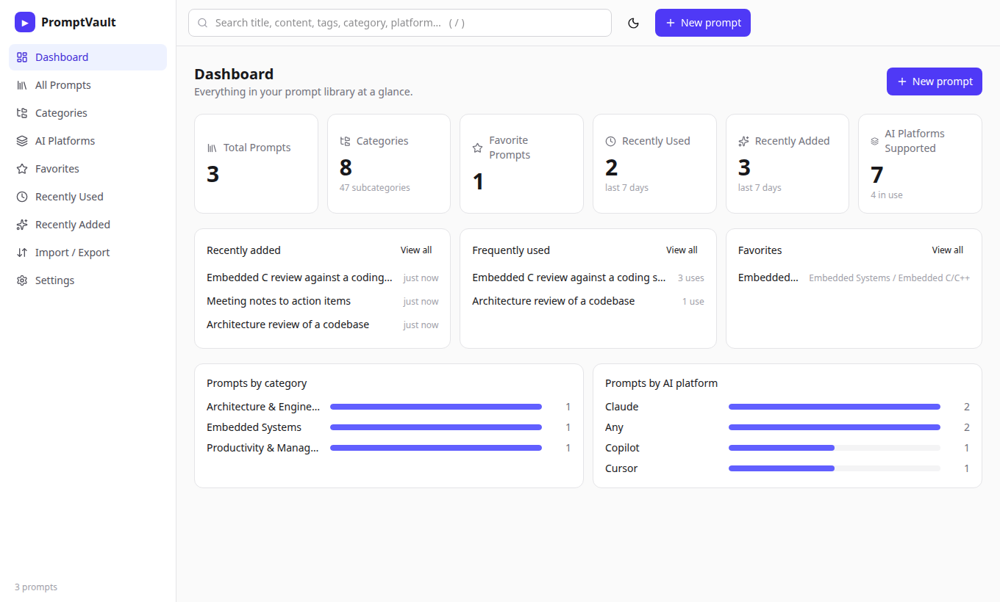

# learnings

This project is designed to help you systematically organize your learnings, experiments, and notebooks related to Large Language Models (LLMs). The following folder structure is recommended for clarity, scalability, and ease of navigation.
## Folder Structure

```
learnings/
│
├── README.md                  # Overview and instructions for this project
│
├── resources/                 # PDFs, papers, articles, and external materials
│
├── notes/                     # Markdown notes, summaries, and theory
│   ├── llm_basics.md
│   ├── transformers.md
│   └── ...
│
├── notebooks/                 # Jupyter/Colab notebooks for experiments
│   ├── 01_intro_to_llms.ipynb
│   ├── 02_finetuning.ipynb
│   └── ...
│
├── code/                      # Python scripts, utilities, and helpers
│   ├── data_preprocessing.py
│   ├── train_llm.py
│   └── ...
│
├── datasets/                  # Sample datasets for training/testing
│   └── README.md
│
├── experiments/               # Results, logs, and configurations of experiments
│   ├── exp1/
│   │   ├── config.yaml
│   │   └── results.log
│   └── ...
│
├── models/                    # Saved or exported models
│   └── README.md
│
├── references/                # Citations, bibliography, and links
│   └── references.bib
│
└── pjt/                       # Self-contained projects, each with its own README
    └── promptvault/           # Local-first AI prompt library manager
```

## Projects

Larger, runnable projects live under [`pjt/`](pjt/). Each one has its own README with setup instructions.

| Project | What it is | Stack |
| --- | --- | --- |
| [promptvault](pjt/promptvault/) | Save, organise, version and reuse AI prompts across platforms. Dashboard, markdown editor with `{{variables}}`, version history with diff and restore, search and filters, JSON/Markdown/CSV import and export, optional password login, and Docker + Fly.io deployment config. | React, TypeScript, Vite, Tailwind, Express, Zod, SQLite, Docker |

