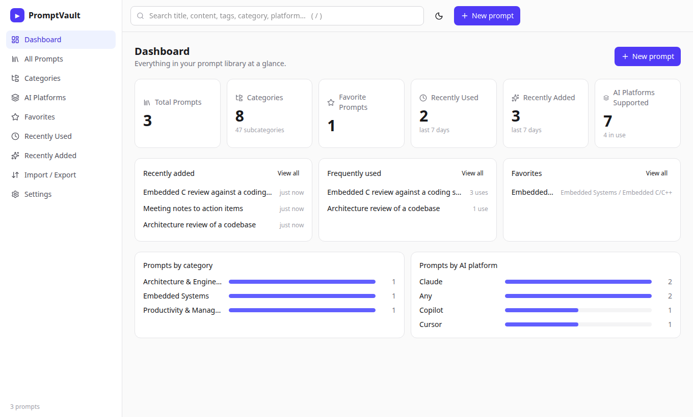
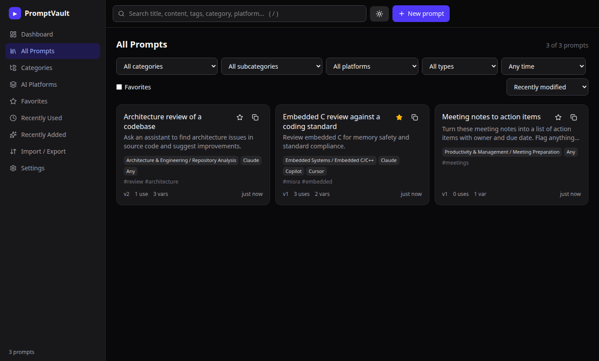
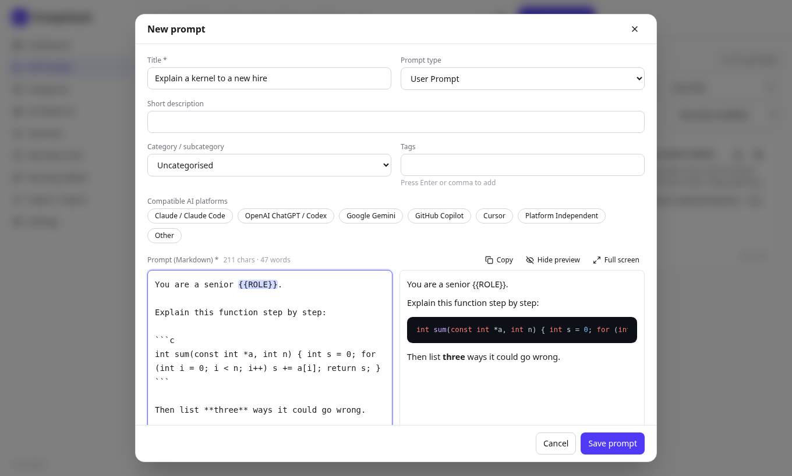
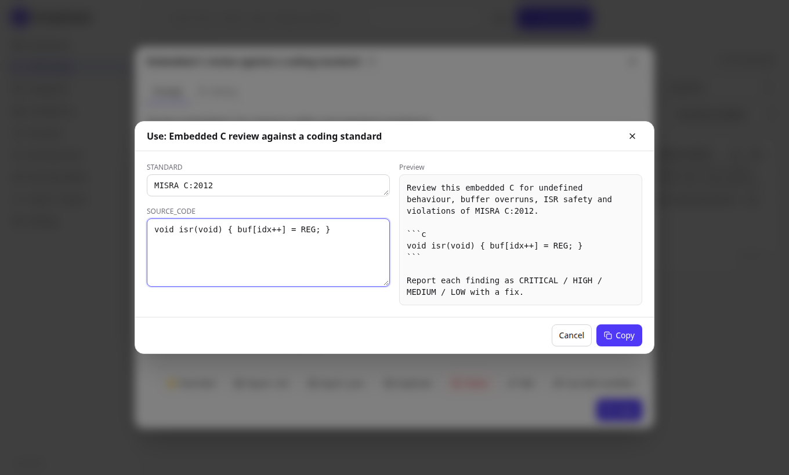
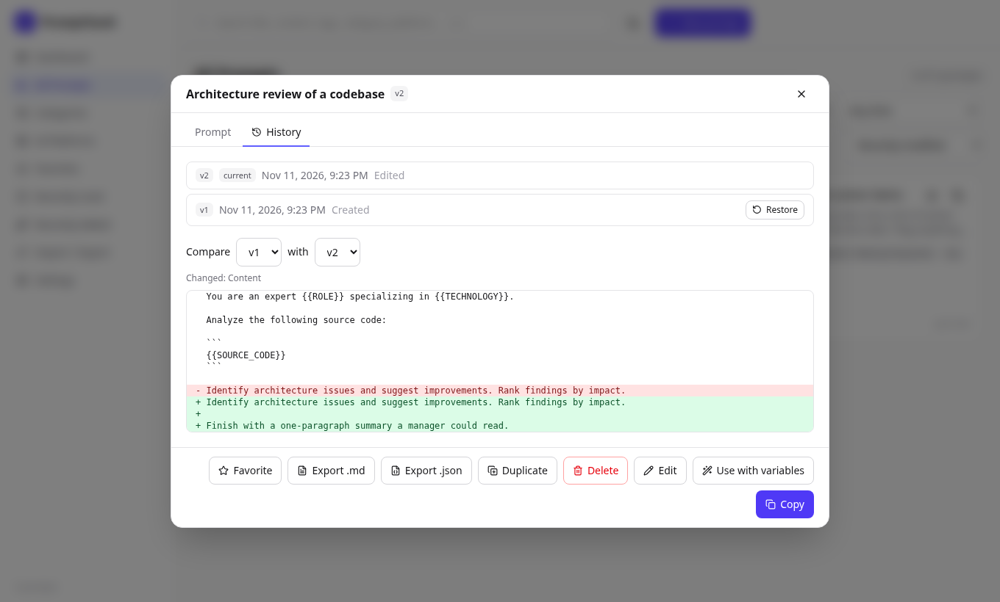
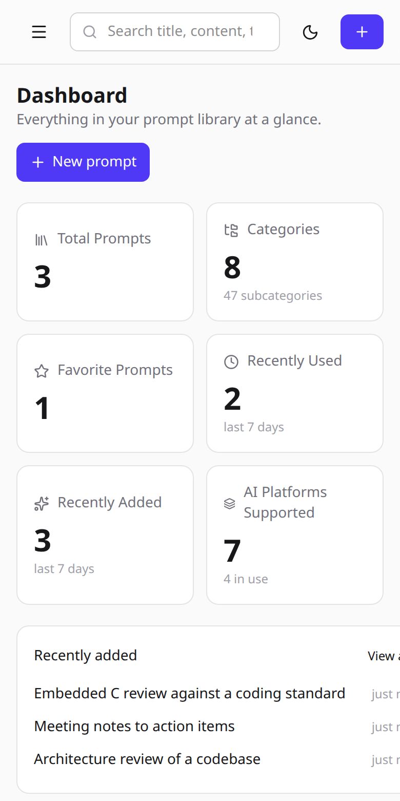

# PromptVault

A local-first library for saving, organising, versioning and reusing AI prompts across platforms
(Claude, ChatGPT/Codex, Gemini, Copilot, Cursor and others).

React + TypeScript + Vite + Tailwind on the front, Express + Zod + SQLite on the back.
Single user, runs on your machine, your prompts stay in one SQLite file.

| Dashboard | Library (dark) |
| --- | --- |
|  |  |

| Editor with live preview | Fill variables, preview, copy |
| --- | --- |
|  |  |

| Version history and diff | Mobile |
| --- | --- |
|  |  |

## Features

- **Dashboard** with totals, favorites, recently added/used, frequently used prompts, and category and platform breakdowns.
- **Prompt CRUD**: create, edit, delete, duplicate, favorite, copy. Each prompt has a type (system, user, agent, workflow, role-based, template), tags, notes, expected output and usage count.
- **Categories**: 8 categories and 47 subcategories pre-seeded. Add, rename, reorder, move and delete them.
- **Editor**: Markdown with live preview and highlighted code blocks, `{{PLACEHOLDER}}` highlighting and detection, full-screen mode, character and word counts.
- **Use with variables**: fill in `{{variables}}`, see the finished prompt, then copy. Each copy counts as a use.
- **Platform variants**: keep a separate version of a prompt per AI platform instead of assuming tools and system instructions are interchangeable.
- **Version history**: every change is a new version. Compare any two, restore any earlier one. History is never overwritten.
- **Search and filters**: instant search across title, description, content, category, tags and platform. Filter by category, subcategory, platform, type, favorites and recency. Six sort orders.
- **Import / export**: JSON import with per-prompt validation, selected or full JSON export, Markdown export per prompt, CSV metadata, and full backup/restore including history.
- **Login and deploy**: optional password login for hosting it online, plus a Dockerfile and Fly.io config.
- **UI**: light and dark themes, responsive layout, keyboard shortcuts (`/` or `Ctrl+K` search, `n` new prompt, `Esc` close).

## Quick start

Requires **Node 22.13+** (uses the built-in `node:sqlite`, so there is no native build step; Node prints an "experimental" warning).

```bash
npm install
npm run dev                        # API on :3001, UI on http://localhost:5173
```

Or as one process:

```bash
npm run build && npm start         # http://127.0.0.1:3001
```

On first run the database is created at `data/promptvault.db` with the categories and three example prompts (delete them any time).

| Variable | Default | Purpose |
| --- | --- | --- |
| `PV_DB` | `data/promptvault.db` | SQLite file location |
| `PORT` | `3001` | Server port |
| `HOST` | `127.0.0.1` | Address to bind. Anything other than loopback **requires** `PV_PASSWORD` |
| `PV_PASSWORD` | unset | Turns on the login screen. At least 12 characters. Unset means no login (local use only) |
| `TRUST_PROXY` | unset | Set to `1` behind a reverse proxy (Fly, nginx) so client IP and secure cookies are right |

The server refuses to start on a non-loopback `HOST` without `PV_PASSWORD`, so it can't be exposed unprotected by accident.

## Scripts

| Command | What it does |
| --- | --- |
| `npm run dev` | API (watch mode) and Vite dev server together |
| `npm run build` | Typecheck, then build the UI into `dist/` |
| `npm start` | Run the API; serves `dist/` too if it exists |
| `npm test` | Run all tests (Vitest) |
| `npm run typecheck` | `tsc --noEmit` over UI, server and shared code |

## Project layout

```
shared/            Code used by both sides
  schema.ts          Zod schemas, types, platform/type lists, default categories
  variables.ts       {{variable}} extraction and filling (+ tests)
server/            Express API
  db.ts              SQLite schema, categories, prompts, versioning, seed data
  app.ts             Routes, validation, import, backup/restore, error mapping
  auth.ts            Password login, signed session cookie, lockout
  index.ts           Entry point: env config, fail-closed checks, serves the built UI
  api.test.ts        API tests against an in-memory database
  auth.test.ts       Login tests
src/               React UI
  App.tsx            Shell: sidebar, search, routing between views, dialogs, shortcuts
  ctx.ts             App-wide context (data, actions, navigation)
  api.ts             Small fetch wrapper with typed errors
  lib/filter.ts      Search, filter and sort engine (+ tests)
  lib/util.ts        Export formats (JSON/Markdown/CSV), clipboard, dates
  components/        Dashboard, Library, PromptCard, PromptEditor, PromptDetail
                     (detail + use dialog + history), Manage (categories, platforms,
                     import/export, settings), ui (shared primitives)
docs/screenshots/  Images used in this README
Dockerfile         Two-stage image (build UI, run server as non-root)
docker-entrypoint.sh  Fixes volume ownership, then drops privileges
fly.toml           Fly.io app config (volume, health check, HTTPS, scale-to-zero)
```

## How it works

**Versioning.** Editing a prompt compares the new content and metadata with the current version. If anything changed, a new row is appended to `versions`; if nothing changed, nothing is saved. Restoring an old version writes its content as a *new* version on top, so no history is ever lost. Favorite and usage changes do not create versions.

**Variables.** Anything matching `{{NAME}}` (letter or underscore first, then letters, digits, `_`, `.` or `-`) is a variable. They are detected in the base prompt and all platform variants.

**Categories.** Two levels: category and subcategory. Deleting one never deletes prompts; they move up to the parent category, or to Uncategorised.

**Import / export format.** Categories are stored by name, not database id, so files are portable between vaults:

```json
{
  "format": "promptvault",
  "version": 1,
  "prompts": [
    {
      "title": "Explain a kernel",
      "content": "You are a senior {{ROLE}}. Explain: {{CODE}}",
      "category": "Embedded Systems",
      "subcategory": "Performance Analysis",
      "promptType": "Reusable Template",
      "platforms": ["Claude / Claude Code", "Cursor"],
      "tags": ["teaching"]
    }
  ]
}
```

Only `title` and `content` are required. A bare JSON array of prompts also works. Each prompt is validated on its own, so one bad entry does not block the rest. The result lists what was imported, what was skipped as a duplicate (same id, or same title and content) and what was invalid, with the reason. A backup file (`GET /api/backup`) additionally contains categories and full history; restoring one replaces everything, atomically.

## API

All routes are under `/api`. Validation errors return `400` with `{ error, issues: [{ path, message }] }`.

| Method | Route | Purpose |
| --- | --- | --- |
| GET / POST | `/prompts` | List all / create |
| GET / PUT / DELETE | `/prompts/:id` | Read / update (new version if changed) / delete |
| POST | `/prompts/:id/duplicate` | Copy as a new prompt at v1 |
| POST | `/prompts/:id/favorite` | Toggle favorite |
| POST | `/prompts/:id/use` | Record a use |
| GET | `/prompts/:id/versions` | Full history, newest first |
| POST | `/prompts/:id/restore/:version` | Restore as a new version |
| GET / POST | `/categories` | List / create |
| PUT / DELETE | `/categories/:id` | Rename or move / delete |
| POST | `/categories/:id/move` | `{ "dir": "up" \| "down" }` among siblings |
| POST | `/import` | Import prompts (array or `{ prompts: [...] }`) |
| GET | `/backup` | Full backup including history |
| POST | `/restore` | Replace everything from a backup |

## Run with Docker

```bash
docker build -t promptvault .
docker run --rm -p 8080:8080 -e PV_PASSWORD='a-long-passphrase' -v promptvault-data:/data promptvault
# open http://localhost:8080 and sign in
```

The image builds the UI in one stage and ships only runtime dependencies. The database lives in the `/data` volume; the container fixes the volume's ownership at start and then runs the server as the unprivileged `node` user.

## Deploy to Fly.io

`fly.toml` and the `Dockerfile` are ready. Fly gives you HTTPS and a persistent volume for the SQLite file. You need a Fly account and `flyctl` ([install](https://fly.io/docs/flyctl/install/)).

```bash
fly auth login
fly launch --no-deploy --copy-config      # choose a globally unique app name when asked; keep the existing fly.toml
fly volumes create pv_data --size 1 --region sin    # same region as primary_region in fly.toml
fly secrets set PV_PASSWORD='a-long-passphrase-of-12-or-more-characters'
fly deploy
fly open
```

Later: `fly deploy` to ship changes, `fly logs` to see output, `fly secrets set PV_PASSWORD=...` to change the password (this signs everyone out).

Things to know:
- **Keep one machine.** SQLite lives on a single volume, so don't scale out. `fly.toml` has the machine stop when idle and wake on the next request (a second or two); set `min_machines_running = 1` if you prefer always-on.
- **The volume is your data.** Create it before the first deploy and don't delete it. Fly snapshots volumes automatically, but also use **Import / Export → Download backup** regularly, or `fly ssh sftp get /data/promptvault.db`.
- **The password is a secret.** Set it with `fly secrets`, never in `fly.toml` or git.
- **Login hardening:** one shared password, a signed `HttpOnly`, `SameSite=Strict` cookie (`Secure` over HTTPS) valid for 7 days, and a 15-minute lockout after 5 wrong attempts per IP.

## Testing

`npm test` runs 30 tests: the API against an in-memory SQLite database (versioning, restore, validation, categories, import, backup round-trip), the login (blocked routes, wrong and right passwords, tampered and expired cookies, lockout), the filter/search engine, variable parsing, and component tests.

## Design notes and limits

- **Single shared password, not user accounts.** Fine for a personal vault; if several people need separate access, put an identity-aware proxy (Cloudflare Access, Tailscale) in front or add real accounts.
- **The login lockout is in memory** and resets on restart. That is fine for one instance. There is no CSP header yet, only basic hardening headers.
- **Open locally means open.** Without `PV_PASSWORD`, the API has no login, so it only binds to `127.0.0.1` by default.
- **Search runs in the browser** over the full prompt list. That is instant for thousands of prompts; beyond that, move to SQLite FTS.
- **Dialogs have no focus trap.** The dialog takes focus on open and Esc closes it, but Tab can leave it.
- **Charts are plain CSS bars**, not a charting library.
- **`node:sqlite` is experimental** in Node 22. If it changes, `server/db.ts` is the only file that touches it.
